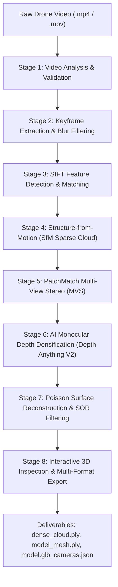

# Birds Eye

> **Autonomous Drone Video to 3D Photogrammetry & AI Depth Reconstruction System**

Birds Eye transforms raw, single-pass aerial drone videos into dense 3D point clouds and textured surface meshes. By bridging classical Structure-from-Motion (COLMAP SfM / MVS) with modern monocular deep learning (Depth Anything V2), Birds Eye reconstructs complex architectural, terrain, and riverbed geometry even from low-altitude or straight-line flight paths.

---

## Key Highlights

- **8-Stage Autonomous Photogrammetry Pipeline**: Full end-to-end processing from raw video to textured 3D mesh.
- **Classical SfM + AI Depth Fusion**: Combines high-accuracy COLMAP multi-view stereo with Depth Anything V2 monocular depth maps aligned via robust RANSAC scale-and-shift estimation.
- **Smart Power & Hardware Dispatcher**: Automatic detection of laptop battery vs. AC charger state to safely switch between NVIDIA CUDA and CPU execution modes, preventing power-draw driver crashes.
- **Single-Command Startup**: Launch both FastAPI backend and Vite/React frontend concurrently with `npm run dev`.
- **Interactive Three.js 3D Viewer**: Real-time point cloud and mesh inspection featuring:
  - Nadir (Top), Isometric, Front, Side viewpoints
  - One-click **Flip Up / Upright** axis reorientation
  - Elevation Relief gradient false-color shader
  - Camera flight trajectory visualization
  - Point-to-point 3D measurement tools
- **Live Pipeline Visual Diagnostics**: Real-time gallery previewing extracted keyframes, contact sheets, point counts, and bounding extents.

---

## Architecture & Pipeline Flow



### Detailed Pipeline Stages

1. **Video Ingestion & Validation**: Analyzes video metadata (duration, FPS, resolution, codec) and generates contact sheets for visual inspection.
2. **Keyframe Extraction**: Computes Laplacian variance for blur detection, selects crisp frames, and removes stationary redundancy.
3. **Feature Detection & Matching**: Extracts scale-invariant feature transform (SIFT) descriptors and performs two-view geometric verification.
4. **Sparse 3D Reconstruction (SfM)**: Solves camera poses, estimates intrinsic and extrinsic parameters, runs bundle adjustment, and triangulates sparse tie points.
5. **Dense Multi-View Stereo (MVS)**: Performs PatchMatch stereo fusion to generate millimeter-level dense point clouds.
6. **AI Depth Completion**: Backprojects untextured areas (e.g. water bodies, smooth roofs) using Depth Anything V2 with RANSAC affine alignment.
7. **Surface Meshing & Cleanup**: Applies Statistical Outlier Removal (SOR) and Screened Poisson Surface Reconstruction to generate watertight surface meshes.
8. **Export & Visualization**: Serves interactive 3D assets to the web interface with flight path camera frustums.

---

## Repository Structure

```
BIRDS_EYE/
├── backend/
│   ├── app/
│   │   ├── api/routes/          # FastAPI endpoints (upload, jobs, viewer, system)
│   │   ├── core/                # Job manager, hardware/battery detection, env
│   │   ├── schemas/             # Pydantic validation schemas
│   │   ├── services/            # Pipeline stage implementations
│   │   │   ├── video_service.py     # Video decoding, keyframes, contact sheets
│   │   │   ├── colmap_service.py    # COLMAP feature extraction & SfM
│   │   │   ├── dense_service.py     # MVS fusion & SOR outlier filtering
│   │   │   ├── ai_depth_service.py  # Depth Anything V2 ONNX densification
│   │   │   ├── mesh_service.py      # Poisson meshing & OBJ/PLY/GLB export
│   │   │   └── export_service.py    # Report generation & bundle packaging
│   │   ├── config.py            # Dynamic configuration & tool resolution
│   │   └── main.py              # FastAPI app & CORS middleware
│   ├── run.py                   # Backend entrypoint with hot reload
│   └── requirements.txt         # Python dependencies
│
├── frontend/
│   ├── src/
│   │   ├── components/
│   │   │   ├── layout/          # Header, Sidebar, Navigation
│   │   │   ├── pipeline/        # Live pipeline step logs & visual previews
│   │   │   ├── upload/          # Video upload & hardware selector
│   │   │   └── viewer/          # Three.js 3D ModelViewer with elevation shader
│   │   ├── api/                 # Axios client & REST endpoints
│   │   ├── types/               # TypeScript interfaces & pipeline schemas
│   │   └── App.tsx              # Main dashboard application
│   ├── package.json             # Frontend dependencies (React, Vite, Three.js)
│   └── vite.config.ts           # Vite development server configuration
│
├── bin/
│   ├── colmap/                  # COLMAP executable distribution (README guide)
│   └── models/                  # AI model weights (Depth Anything V2 ONNX)
├── reference/                   # Sample drone test videos (.gitkeep)
├── workspace/                   # Job artifacts, point clouds, meshes (.gitkeep)
├── dev.js                       # Unified cross-platform dev runner
├── package.json                 # Root script runner (npm run dev)
├── requirements.txt             # Unified project Python dependencies
├── .env.example                 # Environment configuration template
└── README.md                    # Project documentation
```

---

## Quickstart Guide

### 1. Prerequisites

- **Node.js** (v18 or newer)
- **Python** (v3.10, 3.11, or 3.12 recommended)
- **FFmpeg** (accessible in system PATH or configured in .env)
- **COLMAP** (v3.8+; CUDA enabled recommended for fast processing)

### 2. Clone the Repository

```bash
git clone https://github.com/Yashvin186/BirdsEye.git
cd BirdsEye
```

### 3. Setup Python Backend Environment

```bash
# Create and activate virtual environment
python -m venv backend/.venv

# Windows:
backend\.venv\Scripts\activate

# Linux / macOS:
source backend/.venv/bin/activate

# Install dependencies
pip install -r requirements.txt
```

### 4. Setup Frontend Dependencies

```bash
npm --prefix frontend install
```

### 5. Setup External Binaries & AI Weights (Optional)

1. **COLMAP**: Download the official Windows/Linux binary from COLMAP Releases (https://github.com/colmap/colmap/releases) and extract into `bin/colmap/`, or ensure `colmap` is in your system PATH.
2. **Depth Anything V2**: Download the ONNX model weights and place at `bin/models/depth_anything_v2/model.onnx` (see [bin/models/depth_anything_v2/README.md](bin/models/depth_anything_v2/README.md)).

---

## Running the Application

To start **both** the FastAPI backend and Vite frontend with a single command:

```bash
npm run dev
```

Birds Eye will launch:
- **Web Interface**: http://localhost:5173
- **REST API & Swagger Docs**: http://localhost:8000/docs

*(Press `Ctrl + C` in the terminal to stop both servers simultaneously).*

---

## Configuration (.env)

You can create a `.env` file at the root of the project to customize execution parameters (see `.env.example`):

```env
PORT=8000
HOST=127.0.0.1
CORS_ORIGINS=http://localhost:5173,http://127.0.0.1:5173

# Optional: Override auto-detected paths
# COLMAP_EXE=bin/colmap/COLMAP-3.9.1-windows-cuda/COLMAP.bat
# FFMPEG_EXE=ffmpeg
# BIRDS_EYE_WORKSPACE=./workspace

MAX_UPLOAD_SIZE_MB=1024
MAX_VIDEO_DURATION_SEC=1200
```

---

## Testing

Run backend tests using pytest:

```bash
backend\.venv\Scripts\pytest -v
```

Build the frontend for production:

```bash
npm run build
```

---

## License

This project is licensed under the MIT License.
